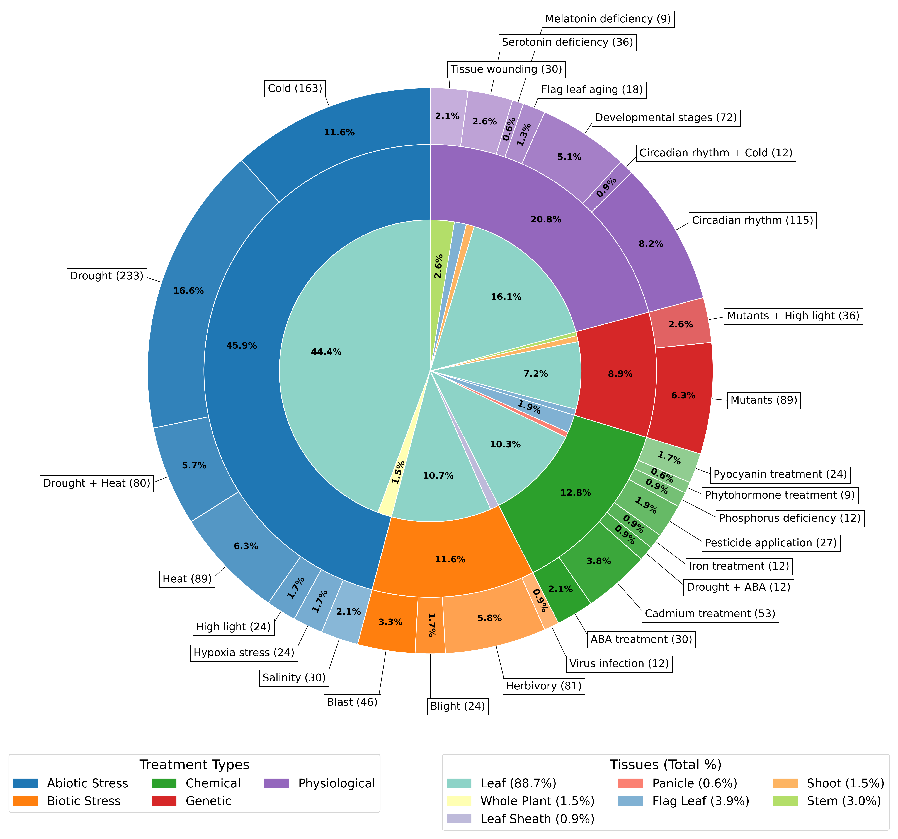
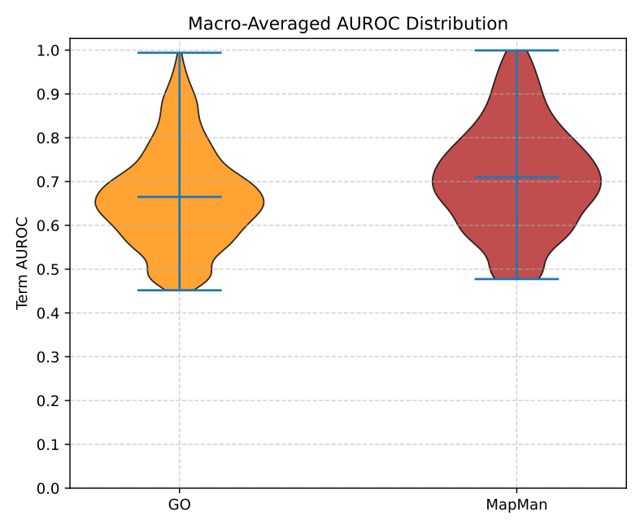
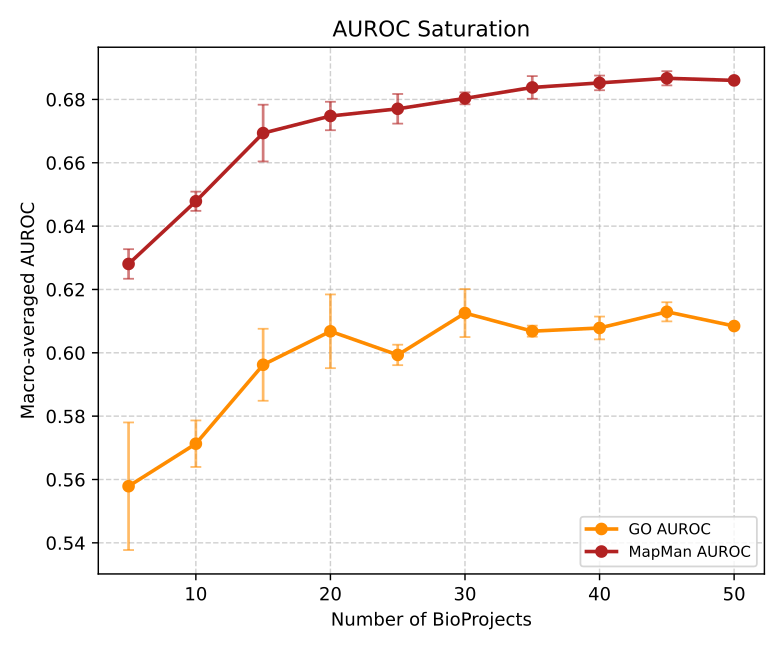
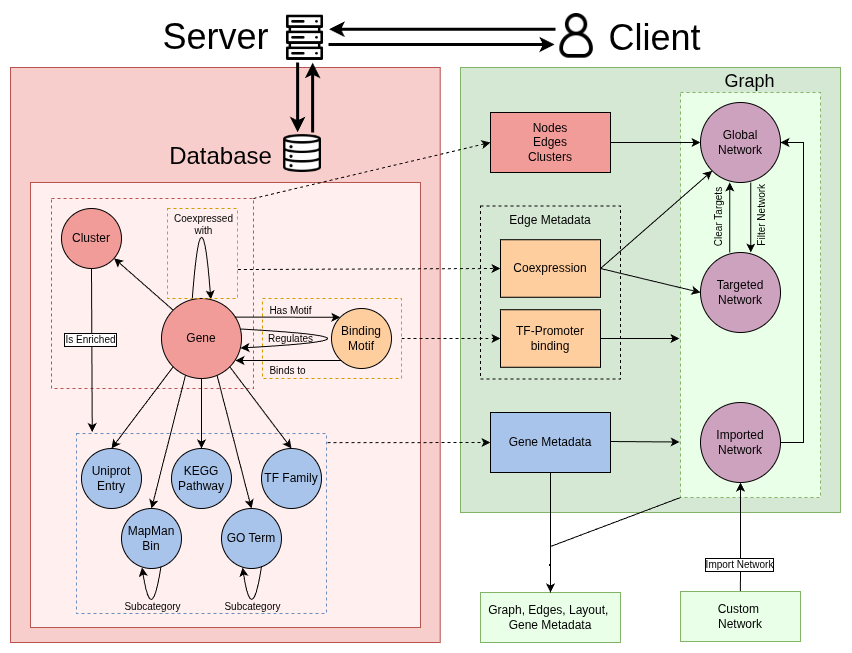

  

## About Rice2Net

Rice2Net is a webtool for the visualization, exploration, and analysis of the rice (*Oryza sativa*) gene regulatory network (GRN) and coexpression data. The tool interfaces with a Neo4j graph database to render topological data into a force-directed graph. Users filter subnetworks, manipulate node visibility, adjust layout parameters, and cross-reference genes with functional annotations.

## Usage

Rice2Net provides a canvas paired with a control panel. By default, the application loads a topological overview of the database. Users navigate the canvas using Pan and Select modes located in the toolbar, and interact with nodes to view metadata. The functionalities are divided into the following sections:

<b>Target Explorer</b>

The **Target Explorer** allows users to isolate subnetworks based on a list of genes.

* **Target Input:** Users input gene queries (RAP-DB IDs, MSU IDs, gene identifiers, or symbols) manually or via a `.txt` file upload.
* **Z-Score Threshold:** Dynamically displayed whenever the active network contains edge `z_score` values (automatically hidden when absent). Bounds adapt to the active network's minimum and maximum `z_score` with a default threshold of `1.28`. Subnetwork extraction (`Filter Subnetwork`) and node expansion operate strictly over edges with `z_score` greater than or equal to the current slider value, allowing users to adjust the threshold and re-filter cleanly.
* **Search Depth:** Determines how many topological steps (edges) away from the target genes the network traverses to pull in neighboring nodes.
* **Prune Dead Ends:** A toggle that removes "leaf" nodes (nodes with a degree of 1) from the filtered subnetwork, retaining the interconnected graph.
* **Connect Neighbors:** This toggle dictates graph traversal logic during subnetwork filtering. When enabled, the filter identifies and draws edges between nodes in the target subset and their retrieved neighbors. When disabled, the filter draws edges radiating from the initial target nodes, resulting in a radial topology. This logic applies to graph manipulation: when enabled during node expansion, the system draws edges between introduced nodes and existing nodes on the canvas. When disabled, introduced nodes connect exclusively to the expanded parent node.
* **Graph Manipulation:** While in "Select" mode, right-clicking a node reveals manipulation options:
  * **Expand:** Fetches and renders database neighbors of a leaf node.
  * **Contract:** Removes leaf nodes attached to the selected node.
  * **Pop:** Deletes the selected node from the visualization.

<b>Analyze</b>

The **Analyze** panel runs on-the-fly network analyses strictly on the currently visible nodes and edges displayed on the canvas.

* **Community Discovery:** Partitions the visible graph into densely interconnected modules using two-level undirected **Infomap** (`@mapequation/infomap` WebAssembly) and evaluates **ORA (Over-Representation Analysis)** via exact upper-tail Hypergeometric tests with per-source Benjamini–Hochberg FDR across **GO:BP**, **GO:MF**, **GO:CC** (using true-path `IS_A`/`PART_OF` DAG propagation), **MapMan**, and **KEGG**.
  * **Markov Time:** Controls module resolution in Infomap (default `1`).
  * **Background Gene Set & Scope:** Choose between *All genes in visible network* (default), *No background* (full genome), or a *Custom list* (pasted or uploaded as `.txt`/`.tsv`/`.csv`), and restrict the statistical universe to *Only annotated* genes or *All genes*.
  * **Adjusted p-value Threshold:** Controls the BH-FDR cutoff (default `0.05`). Only modules with at least one significant ORA term are displayed.
  * **Interactive Cluster Management & ORA Report:** Rename, recolor, toggle visibility, or delete individual clusters directly from the legend or the **ORA Report** modal. The ORA Report provides source filter chips, multi-parameter sorting (*Order by → Then → Then* and clickable headers), horizontal **Fold** bar plots (0-to-max axis on a light-green to dark-red color scale), clickable overlap gene lists, and TSV export for ORA tables and cluster gene lists.
* **Promoter-Binding Motifs:** Searches TF–promoter regulatory relationships across currently visible edges using selectable motif sources (**PlantTFDB**, **JASPAR Core**, **JASPAR Unvalidated**, and **CIS-BP**).
  * Running the search replaces any previous regulation results, displays the matched directional edges, and adds **Regulation** to the Edge Legend in the visible state.
  * Toggling **Regulation** in the Edge Legend shows or hides the current results without re-querying the database, and clicking a regulatory edge displays motif binding events filtered to the selected sources.

<b>Layout</b>

The **Layout** panel provides control over the rendering and the D3.js force simulation engine.

* **Visual Settings:** Controls for toggling Light/Dark themes, base node size, degree-based node scaling (sizes nodes based on edge count), edge width, and edge opacity.
* **Physics Settings:** Modifiers for the graph algorithm. Users adjust Link Length (spring distance), Repulsion (charge force between nodes), Collision Radius (prevents node overlap), and Compression (radial force pulling nodes toward the canvas center).
* **Recalculate Layout:** Reignites the physics simulation to untangle topological structures after filtering or manipulation.

<b>Export</b>

The **Export** suite allows users to extract visualizations and tabular data.

* **Locus ID Format:** A toggle that defines whether exported data files prioritize RAP-DB or MSU formatting for gene identifiers.
* **Export Image (.png):** Generates a high-resolution snapshot of the canvas and active node/cluster legends. A "Show all edges" toggle forces the renderer to paint edges connected to transparent (hidden) nodes.
* **Export Edges (.tsv):** Downloads visible topological links, including source/target mapping, edge weights, Z-scores (when present), directionality flags, interaction signs (`+`/`-`), and active cluster metadata (`#RICE2NET_*` header lines with cluster names, colors, and p-value threshold plus `Source_Cluster` / `Target_Cluster` columns).
* **Export Layout (.json):** Saves spatial coordinates (`x`, `y`), node/edge metadata (including `weight`, `z_score`, and `sign`), and active cluster definitions (gene memberships, names, colors, and ORA threshold), allowing the user to import and restore the full visualization.
* **Export Genes (.tsv):** Downloads a tabular list of visible genes along with flattened metadata columns (Cluster ID/Name/Color/Threshold, Symbol, Transcription Factor families, GO terms, KEGG pathways, MapMan bins, and UniProt entries).

<b>Import</b>

The **Import** section allows users to load networks or restore saved application states, overriding the Neo4j database connection.

* **Load Layout JSON:** Restores a network exported via the "Export Layout (.json)" function without recalculating the physics engine. If cluster metadata is present, clusters are restored with their saved names/colors and automatically re-analyzed with **ORA** using the saved adjusted p-value threshold. If edge `z_score` values are present, the Z-Score slider dynamically updates to the imported network's range (defaulting to `1.28`).
* **Load Edges TSV:** Accepts a `.tsv`, `.csv`, or `.txt` file containing Source and Target columns (with optional Weights, Z-scores, Signs, and Rice2Net cluster metadata/columns). The application builds the topology, queries the database for metadata, calculates a physics layout, configures the Z-Score slider when `Z_Score` values are present, and automatically restores clusters and runs **ORA** when cluster information is included.
* **Revert to Database:** An active import displays its filename in the panel alongside an "✕" button. Clicking this button clears the imported data, resets in-memory clusters and regulation edges, and restores the reference network and its precomputed global clusters from the database.

## Data

<b>Annotation Sources</b>

Rice2Net aggregates annotations and sequence identifiers from databases to provide context for each node. The following annotation sources are integrated into the database:

* **Gene Identifiers:** Primary cross-referencing utilizes **RAP-DB** (Rice Annotation Project) and **MSU** (Michigan State University) locus IDs, alongside gene symbols and GenBank identifiers.
* **Gene Ontology (GO):** Functional classification terms (Biological Process, Molecular Function, Cellular Component) mapped to EBI QuickGO URLs, together with full GO DAG parent-child relationships (`IS_A` and `PART_OF`) stored directly in Neo4j for true-path ORA propagation.
* **MapMan:** Ontology bin codes detailing metabolic pathways and cellular processes.
* **KEGG:** (Kyoto Encyclopedia of Genes and Genomes) Mapped pathway codes and network descriptions.
* **UniProt:** Cross-referenced protein database entries containing reviewed status, protein names, and alias mapping.
* **Transcription Factor (TF) Databases:** TF families are assigned using **PlantTFDB** (for TFs) and **iTAK v1.8** (for Predicted TFs and Predicted TRs).

<b>Coexpression</b>

The dataset comprises 1402 samples from photosynthetic tissues. Treatments include abiotic stress, physiological conditions, chemical applications, biotic stress, and genetic modifications. Genetic modifications involve mutations influencing chloroplast development.

  

The reference transcriptome and proteome for Oryza sativa subsp. japonica (genome assembly IRGSP-1.0) were used. Data was sourced from the following NCBI SRA BioProjects: PRJNA1219119, PRJNA609211, PRJNA1255502, PRJNA575016, PRJNA1073311, PRJNA753062, PRJNA890021, PRJNA917024, PRJNA1020267, PRJNA1293730, PRJNA933387, PRJNA350792, PRJNA1174730, PRJNA1198503, PRJNA1068025, PRJNA358135, PRJNA716196, PRJNA532802, PRJNA603205, PRJNA1120955, PRJNA1229755, PRJNA1148223, PRJNA1067293, PRJNA1234113, PRJNA1234517, PRJNA730675, PRJEB64872, PRJNA1036792, PRJNA1121593, PRJNA751936, PRJNA1011474, PRJNA802358, PRJNA894465, PRJNA1019094, PRJNA741871, PRJNA430015, PRJNA601442, PRJNA450806, PRJNA811347, PRJNA1141930, PRJNA1260801, PRJNA1067651, PRJNA790476, PRJNA767196, PRJNA386172, PRJNA609653, PRJNA631179, PRJNA1010774, PRJNA408068, and PRJNA560146.

RNA-seq data processing was executed using a standard pipeline. Read trimming and quality filtering were performed applying a sliding window size of 4 and a mean quality threshold of 20. Transcript quantification was carried out with 100 bootstrap samples, and quality control metrics were aggregated. BioProjects exhibiting a mean sample alignment rate below 60% were excluded. Transcript abundances were aggregated into gene counts, and data was normalized to generate Variance Stabilizing Transformation (VST) matrices. Prior to network inference, genes were filtered to retain those maintaining a minimum count of 10 in at least 10% of the dataset, with a cross-dataset variance of ≥ 0.5.

The expression matrix was subjected to GRN reconstruction using the Seidr toolkit. An ensemble of six inference algorithms was applied: Pearson correlation, Spearman rank correlation, Partial correlation (PCOR), Random Forests (GENIE3), Context Likelihood of Relatedness (CLR), and Algorithm for the Reconstruction of Accurate Cellular Networks (ARACNE). Seidr's Inverse Rank Product (IRP) method was used to aggregate the networks generated by each algorithm into a consensus network. This consensus network was pruned using Seidr's backbone function with a Z-score threshold of 1.28 to extract the network topology.

<b>Network Performance</b>

The global network was evaluated against functional annotations across both Gene Ontology (GO) and MapMan hierarchies:

| Annotation Source | Terms Evaluated | Macro AUROC | Macro AUPR |
| --- | ---: | ---: | ---: |
| **Gene Ontology (GO)** | 1,788 | 0.6649 | 0.0171 |
| **MapMan** | 780 | 0.7094 | 0.0043 |

Network saturation analysis evaluated the macro-averaged AUROC across dataset subsets of varying BioProject counts. The macro-averaged AUROC reached a performance plateau at 20 BioProjects for GO and MapMan annotations.

  
  

<b>TF-Promoter Binding</b>

Motif references used in TF-Promoter Binding are sourced from **PlantTFDB**, **JASPAR Core**, **JASPAR Unvalidated**, and **CIS-BP**. Rice and homologous TF binding motifs from PlantTFDB, JASPAR, and CIS-BP were obtained. Motifs were associated with loci non-exclusively. Gene promoters (2000 bp upstream of start codon) were extracted using **bedtools**. Promoters were scanned for cis-binding sites using **FIMO** (MEME Suite). This identified regulator-regulated gene pairs within GRNs.

<b>Functional Clusters</b>

Community detection and Over-Representation Analysis (ORA) are integrated directly into Rice2Net's Node.js backend (`server/community_discovery.js`) using established open-source algorithms and statistical primitives:

* **Community Detection (Infomap):** Powered by the official MapEquation C++ **Infomap** engine compiled to WebAssembly via [**`@mapequation/infomap`**](https://github.com/mapequation/infomap) (`@mapequation/infomap/node`), running deterministic two-level undirected flow partitioning (`--two-level --flow-model undirected --seed 42`) with configurable `--markov-time`.
* **Over-Representation Analysis (ORA):** Implements the standard one-sided upper-tail **Hypergeometric test** (equivalent to Fisher's exact test, following the statistical conventions of **g:Profiler**, **clusterProfiler**, and **GOATOOLS**):
  * Exact upper-tail probabilities are computed by summing the Hypergeometric PMF from $k$ to $\min(M, n)$ using [**`@stdlib/stats-base-dists-hypergeometric-pmf`**](https://github.com/stdlib-js/stats-base-dists-hypergeometric-pmf) (avoiding floating-point cancellation at extreme p-values).
  * Multiple-testing correction applies per-namespace **Benjamini–Hochberg (BH) FDR** via [**`@stdlib/stats-padjust`**](https://github.com/stdlib-js/stats-padjust) (matching R's `p.adjust(..., method="BH")`) across all candidate terms ($2 \le M < N$) in each annotation source (`GO:BP`, `GO:MF`, `GO:CC`, `MapMan`, `KEGG`).
  * **Ontology Hierarchy Propagation:** Gene Ontology annotations are propagated up the GO DAG (`IS_A` and `PART_OF` edges sourced from the official Gene Ontology [`go-basic.obo`](https://current.geneontology.org/ontology/go-basic.obo) and stored directly in Neo4j) following the true-path rule; MapMan annotations traverse existing `SUBCATEGORY_OF` edges (excluding bin `35: not assigned`).

For instant startup on the global coexpression network, 8 curated functional clusters (`Markov Time = 1.5`, visible-network annotated background, `FDR ≤ 0.05`, spanning `21,075` genes and `1,776` precomputed `ENRICHED_IN` ORA associations) are stored directly in Neo4j:

| Cluster | Assigned Genes | Significant ORA Terms |
| --- | ---: | ---: |
| **C1 - Translation** | 4,575 | 392 |
| **C2 - External stimulus response** | 4,208 | 300 |
| **C3 - Photosynthesis** | 3,734 | 314 |
| **C4 - Cell wall organisation** | 3,558 | 353 |
| **C5 - Stress response & defense** | 2,833 | 42 |
| **C6 - Transcriptional regulation** | 1,367 | 242 |
| **C7 - Protein folding** | 576 | 93 |
| **C8 - Photosystem II** | 224 | 40 |

## Architecture

Rice2Net operates as a client-side application supported by a Node.js Express middleware server connecting to a Neo4j graph database. The application logic is segmented into domain-specific modules.

  

<b>Client Modules</b>

* **`globals.js`:** Initializes global states (including `CLUSTER_STATE` and `REGULATION_STATE`), feature flags, visual configuration parameters, color palettes, and random number generation functions.
* **`api.js`:** Unified web data adapter (`window.RICE2NET_API`) centralizing backend HTTP requests (and Static Demo Mode hooks) for topology, clusters, metadata, source-filtered regulation/motif queries, Community Discovery, ORA, and lazy overlap-gene lookups.
* **`data.js`:** Executes database initialization routines, loads precomputed global clusters, builds and caches graph adjacency structures, manages dynamic Z-Score edge filtering, handles source-filtered promoter-binding motif fetching, and manages metadata hydration and in-memory reversion.
* **`core.js`:** Processes local file imports (JSON/TSV, including saved cluster restoration and automatic ORA re-analysis) and runs localized force simulation updates during node manipulation.
* **`filter.js`:** Resolves gene identifiers (RAP, MSU, identifiers, symbols), calculates subnetwork traversal based on user targets, and executes targeted graph manipulation actions (expand, pop, contract).
* **`sim.js`:** Manages D3 force layout calculation, physical parameters, batched HTML5 Canvas rendering with viewport culling, and geometric drawing rules for directional edges.
* **`graph.js`:** Implements canvas zoom and pan interactions, calculates view centering, and recalculates visual states during filtering and cluster overlays.
* **`legends.js`:** Generates HTML legend elements and visibility toggles for node types, edge types (revealing Regulation after a Promoter-Binding Motifs search), and interactive cluster controls (color picker, inline rename, ORA inspect, toggle, delete).
* **`analyze.js`:** Controls the **Analyze** panel workflows (**Community Discovery** Infomap + ORA, imported-cluster ORA re-analysis, interactive multi-sort ORA Report modal with horizontal Fold bars, and **Promoter-Binding Motifs** source-filtered search).
* **`ui.js`:** Iterates through visible entities to compute and update statistical counters.
* **`kegg.js`:** Formats external database queries and renders pathway map iframes.
* **`controls.js`:** Manages user input parameters, dynamic debounced Z-Score threshold sliders (auto-hidden when absent), and visual theme toggles (preserving custom cluster colors).
* **`exporters.js`:** Compiles exportable PNG images, Edges TSV, Layout JSON, and Genes TSV files including active cluster assignments, colors, names, and ORA p-value threshold.
* **`interactions.js`:** Processes mouse events, manages coordinate mapping, displays tooltips (including edge signs), renders node/edge detail panels (including cluster ORA shortcuts and source-filtered motif tables), and triggers context menus.

<b>Server Communication</b>

The application retrieves graph data and runs analyses using asynchronous HTTP requests routed through `app/api.js` to Express middleware endpoints (`server/server.js` and `server/community_discovery.js`).

* **Network Initialization:** Upon application load, the client calls `GET /api/network/init` to stream node identifiers, spatial coordinates, degrees, and signed coexpression edges (`weight`, `z_score`, `sign`), alongside `GET /api/network/clusters` to load the 8 precomputed global clusters, colors, and `ENRICHED_IN` ORA results.
* **Community Discovery & ORA:** Clicking **GO** in *Analyze → Community Discovery* sends visible nodes/edges and parameters to `POST /api/analyze/community-discovery` (running `@mapequation/infomap` + exact Hypergeometric/BH-FDR ORA against a cached Neo4j annotation index with GO DAG propagation). Re-importing files with saved clusters invokes `POST /api/analyze/ora` (ORA-only), and expanding overlap genes on DB-stored clusters queries `POST /api/analyze/term-genes`.
* **Metadata Hydration:** Selecting a node queries `GET /api/network/node/:id` (and gene TSV exports batch lookups via `POST /api/network/nodes/batch`).
* **Promoter-Binding Motifs & Regulation:** Clicking **GO** in *Analyze → Promoter-Binding Motifs* batches visible edge pairs with selected sources (`PlantTFDB`, `JASPAR Core`, `JASPAR Unvalidated`, `CIS-BP`) to `POST /api/network/edges/regulates`, filtering against the four boolean source flags on `REGULATES` relationships. Inspecting a regulatory edge queries `GET /api/network/edges/binds` (or `POST /api/network/edges/binds`) filtered by the same selected sources.

<b>Database Architecture</b>

The data is stored in a Neo4j graph database. The schema relies on a central `Gene` node. Peripheral nodes store annotation metadata, ontology hierarchies (`MapMan` `SUBCATEGORY_OF`, `GOTerm` `IS_A` and `PART_OF`), and precomputed global `Cluster` modules (`BELONGS_TO_CLUSTER` and `ENRICHED_IN`). Regulatory and coexpression networks are formed by self-referential relationships between `Gene` nodes.

**Node Statistics** *(164,770 total nodes; 21,167 `Gene` nodes connected in the global coexpression network)*

| Node Label | Record Count |
| --- | ---: |
| `Uniprot` | 102,601 |
| `Gene` | 46,036 |
| `MapMan` | 8,751 |
| `GOTerm` | 6,614 |
| `Motif` | 501 |
| `Pathway` | 160 |
| `TFFamily` | 99 |
| `Cluster` | 8 |

**Topology and Edge Statistics** *(23,245,227 total relationships)*

| Source Node | Relationship | Target Node | Edge Count |
| --- | --- | --- | ---: |
| `Motif` | `BINDS` | `Gene` | 11,583,032 |
| `Gene` | `REGULATES` | `Gene` | 10,658,049 |
| `Gene` | `INTERACTS_WITH` | `Gene` | 824,461 *(788,173 `+`, 36,288 `-`)* |
| `Gene` | `HAS_GO_TERM` | `GOTerm` | 57,794 |
| `Gene` | `HAS_UNIPROT` | `Uniprot` | 49,005 |
| `Gene` | `BELONGS_TO_CLUSTER` | `Cluster` | 21,075 |
| `Gene` | `HAS_MAPMAN` | `MapMan` | 16,237 |
| `Gene` | `IN_PATHWAY` | `Pathway` | 11,261 |
| `GOTerm` | `IS_A` | `GOTerm` | 9,586 |
| `MapMan` | `SUBCATEGORY_OF` | `MapMan` | 8,719 |
| `Gene` | `BELONGS_TO_FAMILY` | `TFFamily` | 2,425 |
| `Cluster` | `ENRICHED_IN` | `GOTerm` / `MapMan` / `Pathway` | 1,776 |
| `Gene` | `HAS_MOTIF` | `Motif` | 984 |
| `GOTerm` | `PART_OF` | `GOTerm` | 823 |

## Team

* **Manuel Almeida** (Lead Developer): manuel.p.almeida13@gmail.com
* **Henrique Niza** (Backend & Security Developer): henrique.niza@itqb.unl.pt
* **Tomás Gil** (Rice2Net Logo Design): tmslongle@gmail.com
* **Pedro Barros, Ph.D.** (Thesis Supervisor): pbarros@itqb.unl.pt
* **Tiago Lourenço, Ph.D.** (Thesis Co-Supervisor): tsantos@itqb.unl.pt
* **M. Margarida Oliveira, Ph.D.** (Lab Director): mmolive@itqb.unl.pt

## Acknowledgements & Funding

### Acknowledgements
We acknowledge the GPlantS lab at ITQB for their support throughout this project, and the Master in Computational Biology and Bioinformatics program from NOVA FCT.

### Funding
This work was supported by FCT - Fundação para a Ciência e a Tecnologia, I.P., through:
* Rice2B project (2022.02916.PTDC, DOI: 10.54499/2022.02916.PTDC)
* Green-it Bioresources for Sustainability R&D Unit (UID/04551/2025, DOI: 10.54499/UID/04551/2025; UID/PRR/04551/2025, DOI: 10.54499/UID/PRR/04551/2025)
* LS4FUTURE Associated Laboratory (LA/P/0087/2020, DOI: 10.54499/LA/P/0087/2020)

